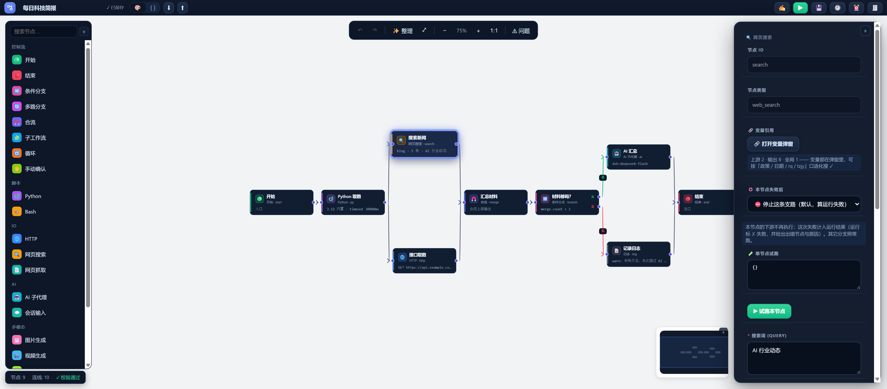
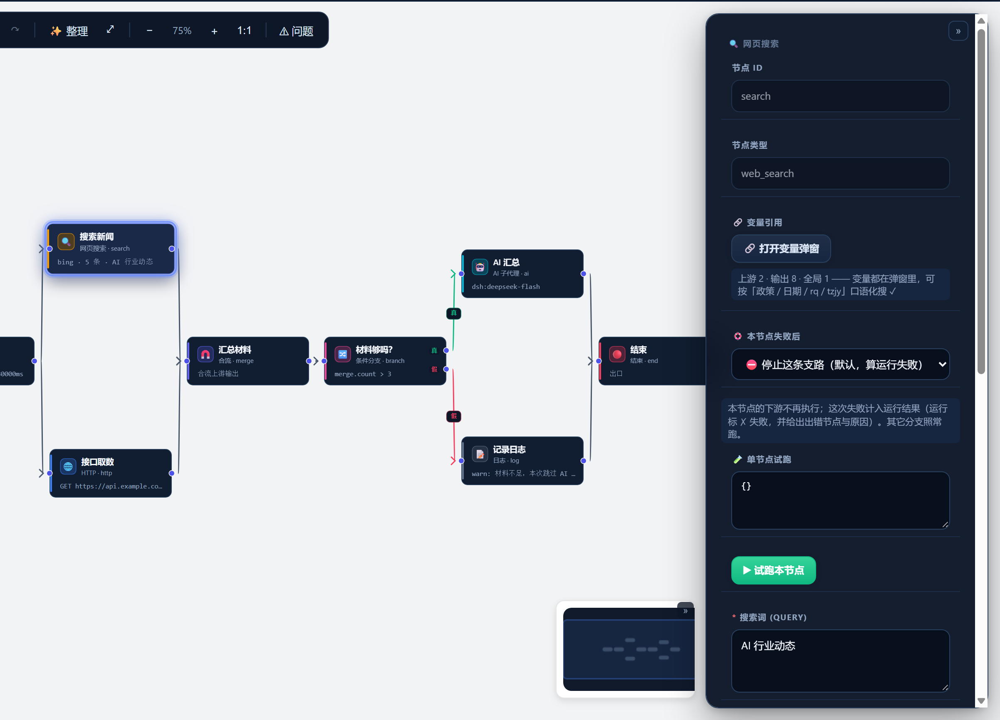

# dag-flow

> **在 DSH 里用画布搭工作流** —— 拖拽 21 种节点、连线即数据流、点 ▶ 就跑。
> Python / Bash / AI 子代理 / HTTP / 网页搜索 / 多模态 / 控制流，全部开箱即用，**不用额外装任何东西**。



**语言 / Language：** [中文](#中文文档) · [English](#english-documentation)

| | |
|---|---|
| 插件名 | `dag-flow`（v0.2.0） |
| 适用 | DSH（DeepSeek Harness）插件 |
| 节点 | 20 个内置类型 + 可自定义扩展 |
| 存储 | `<DSH_HOME>/.dag-flow/` 下的纯 JSON，可读、可携带、可进 git |
| 依赖 | 零外部依赖：内置 Python 3.12 / MinGit Bash / uv |
| 协议 | MIT |

---

# 中文文档

## 目录

- [这是什么](#这是什么)
- [3 步装上，30 秒跑通](#3-步装上30-秒跑通)
- [界面导览](#界面导览)
- [第一个工作流](#第一个工作流)
- [看懂这 5 条就能用](#看懂这-5-条就能用)
- [节点速查（20 个）](#节点速查20-个)
- [常用功能](#常用功能)
- [文件都在哪](#文件都在哪)
- [常见问题](#常见问题)
- [进阶](#进阶)
- [开发者](#开发者)

---

## 这是什么

dag-flow 把「写脚本干活」变成「在画布上连线」：

- 想每天早八点抓新闻 → 写个报告 → 发到邮箱？**连线，不用写调度代码**。
- 想「先搜资料 → 让 AI 总结 → 按质量决定落盘还是告警」？**拖三个节点，连起来**。
- 想让 AI 帮你现搭一个工作流？**说一句话，它把图生成出来**。

它和普通脚本编排工具的区别：

| 特性 | 说明 |
|---|---|
| **可视化画布** | 基于字节开源的 [FlowGram](https://github.com/bytedance/flowgram.ai) free-layout 引擎（Coze Studio 同款），拖拽/连线/缩放/小地图 |
| **零安装运行时** | 插件自带 Python 3.12、MinGit Bash、uv。**你不需要在系统里装 Python 或 Git** |
| **模型来自 DSH** | 插件不存任何模型和密钥，AI 节点直接用你 DSH 里已配置好的模型 |
| **运行前自检** | 点 ▶ 先检查结构与参数，有问题**直接拦住并给出「解决办法」**，不让你跑到一半才炸 |
| **失败可控** | 每个节点可选四档失败策略；节点失败只停它的下游，**其它分支照常跑完** |
| **可定时** | 每个工作流可配 cron，到点自动跑，画布上照样能看到运行状态 |

---

## 3 步装上，30 秒跑通

### 1. 构建插件

```bash
cd dag-flow
npm install
npm run build          # 产出 dist/index.js（宿主）+ dist/client.js（界面）
```

### 2. 装进 DSH

```bash
dsh plugin add <dag-flow 的绝对路径>
```

### 3. 重启 DSH

**重启 `dsh web`**（宿主启动时才加载插件），然后刷新页面。
侧栏出现 **「工作流」** 图标 = 装好了。

> **开发模式**：profile 里通常是软链（`link:D:/.../dag-flow`），改完代码 `npm run build` 后**重启 dsh web** 生效；只改界面（client）时**刷新页面**即可。

### 验证装好了

打开画布 → 点 **📂** → 输入一个新名字（如 `hello`）→ 回车创建 → 点 **▶** → 弹「✓ 自检通过」→ 点「开始运行」。
底部显示 `节点: 2 连线: 1 ✓ 校验通过`，很快出现「✓ 运行成功」浮窗 = 一切正常（新建出来的是 `start → end` 最小工作流）。

---

## 界面导览


| 位置 | 是什么 |
|---|---|
| **顶部标题栏** | 工作流名 + 保存状态；两个**视图页签** `🎨` 画布 / `{ }` JSON；`⬇` 导出（JSON / PNG / SVG）、`⬆` 导入；右侧一排：`✍️` 工作流参数 / `▶` 运行 / `💾` 保存 / `🕘` 历史版本 / `⏰` 定时任务 / `🧾` 运行日志 |
| **左侧节点面板** | 21 种节点按用途分组（控制流 / 脚本 / IO / AI / 多模态 / 数据）。**拖到画布**即添加；顶部有搜索框 |
| **中间画布** | 拖拽移动、拖动端口连线、滚轮缩放；右上角工具条有「整理」（自动布局）、缩放档位、`1:1`、`⚠ 问题` |
| **右侧参数面板** | 选中节点后在这里改参数。见下图 |
| **右下小地图** | 大图导航，点一下跳到对应位置 |
| **底部状态栏** | 节点数 / 连线数 / 校验结果（`✓ 校验通过` 或问题数） |

**右侧参数面板**（选中节点后）：



从上到下依次是：

- **节点 ID** —— 数据引用要用它（`{{节点ID.out}}`）
- **节点类型**
- **🔗 变量引用** —— 点「打开变量弹窗」看这个节点**能取到哪些变量**（上游有哪些、全局参数有哪些、自己输出什么），点一下即复制。支持口语化搜索：输 `政策`、`日期`、`rq`（拼音首字母）、`tzjy` 都能命中
- **🛟 本节点失败后** —— 四档失败策略（见下文）
- **参数区** —— 该节点自己的参数（代码 / 提示词 / URL / 模型…）
- **🧪 单节点试跑** —— 只跑这一个节点，用来调提示词或调脚本，不用跑整条流程

---

## 第一个工作流

### 搭一个能跑的工作流

1. 打开「工作流」面板 → 点 **📂** → 输入一个新名字 → 回车创建
2. 从左侧拖 **Python** 到画布 → 在右侧「参数」里写代码，例如：

   ```python
   import json
   print(json.dumps({"msg": "hello", "n": 3}))
   ```

3. 拖一个 **日志** 节点 → 从 Python 节点的输出端口**拖一条线**到日志节点
4. 选中日志节点，把 message 写成 `{{python1.out.msg}}` ← **引用了上游的输出**
5. 点 **▶** → 自检 → 运行

> **为什么必须连线？** 本项目有「**引用即依赖**」规则：你引用了谁的输出，就必须有一条连线路径能走到它。否则自检会报 `REF_NO_EDGE` 并拦住运行 —— 这是为了防止「看起来能跑、其实数据取不到」的静默错误。

---

## 看懂这 5 条就能用

### 1. 节点 + 连线 = 一张有向图

- 有 **`start`** 作为入口（1 个），**`end`** 作为出口（可多个）。
- 一个节点**只要有一条被激活的入边就会执行**；入边全都没激活 → 它被标记为 **skipped（灰色）**。
- 执行是**分层并行**的：同一层的多个节点会**同时**跑。

### 2. 数据传递用 `{{ }}`

| 写法 | 含义 |
|---|---|
| `{{节点ID.out}}` | 该节点的完整输出 |
| `{{节点ID.out.字段}}` | 取字段 |
| `{{节点ID.out.list.0}}` | 取数组第 0 项 |
| `{{vars.变量名}}` | 全局变量（`设置变量` 节点写入的） |
| `{{inputs.参数名}}` | 工作流参数（点顶部 **✍️** 配置） |

> **两种用法别混**：
> - **参数里的字符串**用模板语法 `{{节点ID.out.字段}}`；
> - **`if` / `switch` / `loop` 的条件**用**表达式**语法，节点输出是**拍平**的：写 `Number(results.py_gate) > 0`，**不要**写 `{{...}}`。

### 3. 分支与合流

- **条件分支（if）**：两个出口 `true` / `false`，各自连到不同下游。
- **多路分支（switch）**：按一个值分发到多个出口；卡片上可以点分支键**就地改**。
- **合流（merge）**：多个并行分支汇入一个节点，把它们的输出打包成一个对象，用 `{{merge.out.<上游节点ID>}}` 取。
- 未被选中的分支会被标为 **skipped**，不影响整次运行的结果。

### 4. 失败策略（每个节点可选四档）

选中节点 → **🛟 本节点失败后**：

| 选项 | 行为 | 算不算失败 |
|---|---|---|
| ⛔ 停止这条支路（默认） | 下游不再执行 | **算失败**（运行标 ✗ 并给出错节点） |
| ⏭ 跳过这条支路 | 下游不再执行 | 不算失败 |
| 🛟 忽略失败 | 下游**照常执行** | 不算失败 |
| ↪ 失败后跳转 | 跳到指定节点（**目标只执行一次**） | 算失败 |

> 关键语义：**节点失败只停它自己的下游，其它分支照常跑完**（不会整张图停摆）。

### 5. 点 ▶ 之前会先自检

自检会检查：结构合法性、**引用是否都有连线**、不可达 / 死路 / 环路、必填参数、分支键是否缺失、`switch` 的 case 与连线是否一致、循环边界与循环体、合流上游数量、子工作流是否存在、AI 节点选的模型是否还在……

- 有问题 → 弹出**「自检未通过」**，每条都带 **👉 解决办法**，并且**弹窗里没有「运行」按钮**——必须先去改。
- 没问题 → 弹「✓ 自检通过」→ 点「▶ 开始运行」。

---

## 节点速查（20 个）

### 控制流

| 类型 | 显示名 | 用途 | 关键参数 |
|---|---|---|---|
| `start` | 开始 | 工作流入口（恰好 1 个） | `params` 即输出 |
| `end` | 结束 | 工作流出口（≥1 个） | `outputs?` |
| `if` | 条件分支 | 二选一 | `condition`（**表达式**） |
| `switch` | 多路分支 | 多选一 | `value`, `cases` |
| `merge` | 合流 | 并行分支汇合（≥2 上游） | `keys?` |
| `subflow` | 子工作流 | 调用另一个已保存的工作流 | `workflowName`, `inputs?` |
| `loop` | 循环 | 迭代计数 + 每轮调子工作流 | `count?` / `while?` / `over?`, `body?` |
| `manual` | 手动确认 | 暂停等人工点确认 | `prompt` |

### 脚本 / IO / AI / 多模态 / 数据

| 类型 | 显示名 | 用途 | 关键参数 |
|---|---|---|---|
| `python` | Python | 跑 Python 3.12 脚本 | `code` 或 `codePath` |
| `bash` | Bash | 跑 Bash 脚本 | `code` 或 `codePath` |
| `http` | HTTP | 发 HTTP 请求 | `method?`, `url`, `headers?`, `body?` |
| `web_search` | 网页搜索 | 搜索（多个免 key 引擎） | `query`, `provider?`, `count?`, `timeRange?` |
| `web_fetch` | 网页抓取 | 抓网页正文 / 解析 JSON | `url`, `maxChars?` |
| `subagent` | AI 子代理 | 调 DSH 的模型 | `prompt`, **`model`（必填）** |
| `session_input` | 会话输入 | 读某个会话的内容 | `sessionId`, `limit?` |
| `image_generate` | 图片生成 | 文生图（OpenAI images 兼容） | `prompt`, `baseURL`, `apiKey`/`apiKeyEnv` |
| `video_generate` | 视频生成 | 异步提交 + 轮询 | `submitUrl`, `pollUrl` |
| `file_save` | 文件保存 | 把文本或 URL 存进数据根 | `content`/`url`, `filename` |
| `set_var` | 设置变量 | 写全局变量供下游用 | `vars` |
| `log` | 日志 | 打一行日志（常用来收尾） | `level?`, `message` |

> **Python / Bash 节点没有 stdin**：上游数据要用模板内插进代码里，例如
> `raw = r'''{{fetch.out}}'''`（**用原始字符串 `r'''...'''`**，否则 Windows 路径里的 `\r` 会变回车）。

---

## 常用功能

### 🧾 运行日志（告别黑盒）

点顶部 **🧾** → 每个节点一行，展开能看到：

- **原始参数**（保留 `{{}}` 的写法）→ **实际入参**（模板已展开的真实值）
- **出参**（该节点的输出）
- **↳ 引用上游**：这个节点引用了谁
- AI 节点还会显示：模型、走宿主还是直连、**token 用量**、结束原因

支持搜索、只看失败/跳过、点条目直接**在画布上选中该节点**。

### ⏰ 定时任务

点 **⏰** → 加一条 → 填 **cron**（标准 5 字段：`分 时 日 月 周`，如 `0 8 * * 1-5` = 工作日早八点）→ 点「保存」生效。

- 状态胶囊 `● 启用中` / `○ 已停用`，点一下即切换。
- 定时触发时**没人能点确认**，所以 `手动确认` 节点会被自动放行（界面会标 `⏭ 自动通过`）。
- 触发时是从磁盘读最新定义，**改完 JSON 不用重启**。
- **前提：`dsh web` 必须常驻**（调度器在插件进程里，进程退出就不触发）。

### 🕘 历史版本

手动 **💾** 保存会存一份版本快照（**内容没变则不生成**，最多保留 20 份）；自动保存（编辑后 2 秒）不生成版本。点 🕘 可随时回载。

### ⬇ 导出 / ⬆ 导入

- **导出 JSON**、**导出图片 PNG**、**导出矢量图 SVG**（把画布画成图，方便贴到文档里）
- **导入 JSON** 直接恢复一个工作流

### 🔗 变量弹窗

选中节点 → 点「🔗 打开变量弹窗」：

- **上游变量**：按来源节点分组，能取到什么一目了然
- **本节点输出**：跑过一次之后，按**真实输出**反推字段（不是猜的）
- **全局变量**：工作流参数 + `设置变量` 写进去的值

点任意变量即复制，直接粘到参数里。

### ✍️ 工作流参数

点顶部 **✍️** 定义参数（如 `收件邮箱`），运行时填入或用默认值；脚本里用 `{{inputs.参数名}}` 取。

---

## 文件都在哪

所有数据都在 **DSH 数据根**下的 `.dag-flow/`，与「当前工作区」无关，不污染系统目录：

```text
<DSH_HOME>/.dag-flow/          ← DSH_HOME 默认是 ~/.dsh
├── workflow/                  ← 工作流定义（每个工作流一个 .json）
│   ├── config/                ← 节点配置文件（如 mail.json 邮件凭据）
│   └── versions/              ← 历史版本快照
├── runs/                      ← 运行记录
├── logs/                      ← 按天日志
├── tmp/                       ← 临时文件
├── scripts/                   ← 节点用的脚本文件（codePath 指向这里）
└── schedules.json             ← 定时任务配置
```

- 存储根取 `DSH_HOME` 环境变量（便携/自定义安装可以指到别处），没设就退回 `~/.dsh`；换个工作区打开，工作流还在原处。
- 工作流定义是**纯 JSON**，可以进 git、可以手改、可以复制给别人。
- `file_save` 的产出落在 `.dag-flow/` 下（`filename` 里带子目录就会建子目录，如 `reports/日报.md`）。
- 同名文件**不会覆盖**，会自动改名为 `报告-2.md`。
- Python / Bash 节点默认就在这个数据根里执行（`cwd` 留空 = `<DSH_HOME>/.dag-flow`），所以脚本里的相对路径产物也落在这儿；节点参数填 `cwd` 可完全覆盖。

---

## 常见问题

**Q：装好后侧栏没有「工作流」入口？**
A：宿主只在启动时加载插件 —— **重启 `dsh web`**，再刷新页面。

**Q：改了工作流 JSON，界面没变化？**
A：界面有缓存。**先刷新页面**再操作。

**Q：点 ▶ 没反应 / 弹出「自检未通过」？**
A：这是设计如此。自检未通过时**不提供「仍然运行」**，请按弹窗里每条问题下面的 **👉 解决办法** 改完再跑。

**Q：报 `REF_NO_EDGE` / `DATAFLOW_NO_EDGE`？**
A：你引用了某个节点的输出，但**没有连线**连到它。从那个节点拖一条线过来（直连或经合流汇合）。

**Q：Python / Bash 节点报错找不到命令？**
A：插件自带运行时（Windows 内置；macOS/Linux 首次使用时自动下载）。首次运行请保持联网；也可手动 `npm run fetch:runtime`。

**Q：AI 节点报 `MODEL_REQUIRED`？**
A：`AI 子代理` 节点的**模型是必填**的。在右侧参数里选一个 DSH 已配置的模型。

**Q：AI 节点报余额/配额错误（如 HTTP 402）？**
A：这是**模型提供方账户**的问题，不是插件问题。换个有余额的模型，或给账户充值。

**Q：节点为什么是灰色的？**
A：灰色 = **skipped（未激活）**。通常是它所在的分支条件没命中，或它的上游失败了 —— 属正常语义，不是错误。

**Q：想让某个节点失败也不影响流程？**
A：把它的 **🛟 本节点失败后** 设成「忽略失败」或「跳过这条支路」。

**Q：运行中发现跑错了，能中途取消吗？**
A：能。点头部的取消按钮，Python/Bash 进程会被真正 kill 掉。

**Q：中文输出乱码？**
A：插件已强制 `PYTHONIOENCODING=utf-8`。若你在**插件之外**单独跑那些脚本，请自己带上这个环境变量。

---

## 进阶

### 循环怎么用

`loop` 节点本身只产出迭代序列（`count` / `items`）；**真正的"循环执行一段流程"靠循环体**：在 `loop` 的参数里选一个**子工作流**作为循环体，每轮把 `{{vars.loopItem}}` / `{{vars.loopIndex}}` 注入进去，子工作流的输出会依次收集到 `loop.out.items`。

### 自定义节点

```ts
import { registerNode } from 'dag-flow';

registerNode({
  type: 'my_op',
  schema: { type: 'object', required: ['text'], properties: { text: { type: 'string' } } },
  run: async (ctx, params) => ({
    status: 'success',
    out: params.text.toUpperCase(),
    durationMs: 0,
    startedAt: new Date().toISOString(),
    endedAt: new Date().toISOString(),
  }),
});
```

### 邮件节点凭据

放在 `<DSH_HOME>/.dag-flow/workflow/config/mail.json`（默认即 `~/.dsh/.dag-flow/workflow/config/mail.json`）：

```json
{ "host": "smtp.163.com", "port": 465, "user": "you@163.com", "pass": "授权码" }
```

工作流 JSON 里**不含凭据**。也可用环境变量覆盖。

### 更深的文档

| 文件 | 内容 |
|---|---|
| [`docs/DATAFLOW.md`](docs/DATAFLOW.md) | 数据传递细节 |
| [`docs/ERROR_REFERENCE.md`](docs/ERROR_REFERENCE.md) | 全部错误码与含义 |
| [`docs/SCHEDULE-PLAN.md`](docs/SCHEDULE-PLAN.md) | 定时任务设计 |
| [`docs/EXEC-MODEL-MERGE.md`](docs/EXEC-MODEL-MERGE.md) | 执行模型（失败策略语义） |
| [`RUNTIME_SETUP.md`](RUNTIME_SETUP.md) | 运行时（Python/Bash/uv）说明 |

---

## 开发者

```bash
npm run typecheck        # TypeScript 类型检查
npm run build            # 构建 host + client 两个产物
npm run test:offline     # 离线回归套件（36 个文件）
npm run fetch:runtime    # 按需下载内置运行时
```

**改完代码要重打产物**：

| 改了什么 | 要做什么 |
|---|---|
| 宿主代码（`src/` 里非 client 部分） | `npm run build:host` + **重启 dsh web** |
| 界面代码（`src/client/**`） | `npm run build:client` + **刷新页面** |
| 只改工作流 JSON | 什么都不用做（刷新页面即可） |

本地跑一个工作流 JSON（不需要 DSH 真机）：

```bash
node scripts/run-example.mjs <工作流.json>
node scripts/run-example.mjs <工作流.json> --inputs '{"k":"v"}'
```

---

## License

MIT

---
---

# English Documentation

## Table of contents

- [What it is](#what-it-is)
- [Install in 3 steps](#install-in-3-steps)
- [UI tour](#ui-tour)
- [Your first workflow](#your-first-workflow)
- [Five things to know](#five-things-to-know)
- [Node reference (20)](#node-reference-20)
- [Key features](#key-features)
- [Where files live](#where-files-live)
- [FAQ](#faq)
- [Development](#development)

---

## What it is

**dag-flow is a visual workflow builder plugin for DSH (DeepSeek Harness).**
Instead of writing orchestration code, you drag nodes onto a canvas, connect them, and press Run.

- Scrape news → write a report → email it every weekday at 8am? **Connect nodes, no scheduler code.**
- "Search → let AI summarize → save if good, alert if not"? **Three nodes and two wires.**
- Want AI to build the graph for you? **Describe it in one sentence.**

Highlights:

| Feature | Detail |
|---|---|
| **Visual canvas** | Built on ByteDance's open-source [FlowGram](https://github.com/bytedance/flowgram.ai) free-layout engine (same as Coze Studio) — drag, connect, zoom, minimap |
| **Zero runtime setup** | Ships its own Python 3.12, MinGit Bash and uv. **You don't need Python or Git installed** |
| **Models come from DSH** | The plugin stores no models or API keys; AI nodes use whatever you already configured in DSH |
| **Pre-run self-check** | Pressing Run first validates structure and parameters, **blocks on errors and shows how to fix each one** |
| **Controllable failures** | Four failure policies per node; a failing node only stops **its own** downstream, other branches finish |
| **Schedulable** | Per-workflow cron; scheduled runs still light up the canvas |

---

## Install in 3 steps

### 1. Build

```bash
cd dag-flow
npm install
npm run build          # produces dist/index.js (host) + dist/client.js (client)
```

### 2. Install into DSH

```bash
dsh plugin add <absolute path to dag-flow>
```

### 3. Restart DSH

**Restart `dsh web`** (the host loads plugins at startup), then refresh the page.
A **"Workflow"** icon appears in the sidebar — you're done.

> **Development mode**: the profile usually links to this directory (`link:D:/.../dag-flow`). After `npm run build`, **restart `dsh web`**; if you only changed client code, a **page refresh** is enough.

### Verify

Open the canvas → click **📂** → type a new name (e.g. `hello`) → Enter to create → press **▶** → a "self-check passed" dialog appears → click **Start**.
The status bar shows `节点: 2 连线: 1 ✓ 校验通过` and a "run succeeded" toast appears shortly — the created workflow is the minimal `start → end` one.

---

## UI tour


| Area | What it is |
|---|---|
| **Header** | Workflow name + save state; two **view tabs** `🎨` canvas / `{ }` JSON; `⬇` export (JSON / PNG / SVG) and `⬆` import; then `✍️` workflow params / `▶` run / `💾` save / `🕘` version history / `⏰` schedules / `🧾` run log |
| **Left palette** | 20 node types grouped by purpose. **Drag onto the canvas** to add. Search box at the top |
| **Canvas** | Drag to move, drag from a port to connect, scroll to zoom. Toolbar has auto-layout, zoom presets, `1:1` and `⚠ issues` |
| **Right panel** | Parameters of the selected node (see below) |
| **Minimap** | Click to jump around large graphs |
| **Status bar** | Node count / edge count / validation result |

**Right panel** (with a node selected):


- **Node ID** — used by data references (`{{nodeId.out}}`)
- **Node type**
- **🔗 Variables** — opens a dialog listing every variable this node can read (upstream nodes, globals) and what it outputs. Click to copy. Fuzzy search works, including pinyin initials
- **🛟 On failure** — the four failure policies
- **Parameters** — node-specific settings (code, prompt, URL, model…)
- **🧪 Test this node** — run just this node, e.g. while tuning a prompt or script

---

## Your first workflow

### Build a workflow that runs

1. Open the Workflow panel → **📂** → type a new name → Enter
2. Drag a **Python** node onto the canvas, write code in its parameters:

   ```python
   import json
   print(json.dumps({"msg": "hello", "n": 3}))
   ```

3. Drag a **log** node and **draw a wire** from the Python node to it
4. Set the log message to `{{python1.out.msg}}` — that's a **reference to the upstream output**
5. Press **▶** → self-check → run

> **Why is the wire mandatory?** This project enforces **"a reference implies a dependency"**: if you reference a node's output, there must be a connected path to it. Otherwise the self-check reports `REF_NO_EDGE` and blocks the run — this prevents silent "looks fine but the data was never there" failures.

---

## Five things to know

### 1. Nodes + edges = a DAG

- One **`start`** entry, one or more **`end`** exits.
- A node runs if **any** of its incoming edges is active; if none are, it is marked **skipped** (grey).
- Execution is **layered and parallel**: nodes in the same layer run **concurrently**.

### 2. Pass data with `{{ }}`

| Syntax | Meaning |
|---|---|
| `{{nodeId.out}}` | full output of a node |
| `{{nodeId.out.field}}` | a field |
| `{{nodeId.out.list.0}}` | array index |
| `{{vars.name}}` | global variable |
| `{{inputs.name}}` | workflow parameter |

> **Don't mix the two syntaxes**: strings in parameters use the template form `{{nodeId.out.field}}`; **conditions** in `if` / `switch` / `loop` use **expression** syntax with flattened outputs — write `Number(results.py_gate) > 0`, **not** `{{...}}`.

### 3. Branching and merging

- **if** — two ports (`true` / `false`).
- **switch** — many ports, dispatched on one value.
- **merge** — joins parallel branches into one object; read with `{{merge.out.<upstreamNodeId>}}`.
- Inactive branches are marked **skipped** and don't affect the run result.

### 4. Failure policy (four options per node)

| Option | Behaviour | Counts as failure |
|---|---|---|
| ⛔ Stop this branch (default) | downstream not executed | **yes** |
| ⏭ Skip this branch | downstream not executed | no |
| 🛟 Ignore failure | downstream **still runs** | no |
| ↪ Jump to node | jump to a target (**runs at most once**) | yes |

> A failing node only stops **its own** downstream — other branches complete normally.

### 5. Run always begins with a self-check

The self-check validates structure, **references-without-edges**, unreachable nodes, cycles, required parameters, missing branch keys, `switch` cases vs. edges, loop bounds and bodies, merge upstreams, sub-workflow existence, and whether the selected model still exists.

- Errors → a **"self-check failed"** dialog lists every problem with a **👉 fix**, and **offers no Run button** — you must fix it first.
- Clean → a "passed" dialog → click **Start**.

---

## Node reference (20)

| Type | Purpose | Key parameters |
|---|---|---|
| `start` | Entry point (exactly one) | `params` is the output |
| `end` | Exit (one or more) | `outputs?` |
| `if` | Two-way branch | `condition` (**expression**) |
| `switch` | Multi-way branch | `value`, `cases` |
| `merge` | Join parallel branches (≥2 upstreams) | `keys?` |
| `subflow` | Call another saved workflow | `workflowName`, `inputs?` |
| `loop` | Iteration count + optional sub-workflow body | `count?` / `while?` / `over?`, `body?` |
| `manual` | Pause for human confirmation | `prompt` |
| `python` | Run a Python 3.12 script | `code` or `codePath` |
| `bash` | Run a Bash script | `code` or `codePath` |
| `http` | HTTP request | `method?`, `url`, `headers?`, `body?` |
| `web_search` | Web search (keyless engines) | `query`, `provider?`, `count?`, `timeRange?` |
| `web_fetch` | Fetch page text / parse JSON | `url`, `maxChars?` |
| `subagent` | Call a DSH model | `prompt`, **`model` (required)** |
| `session_input` | Read a session's content | `sessionId`, `limit?` |
| `image_generate` | Text-to-image | `prompt`, `baseURL`, `apiKey`/`apiKeyEnv` |
| `video_generate` | Async submit + poll | `submitUrl`, `pollUrl` |
| `file_save` | Save text or a URL into the data root | `content`/`url`, `filename` |
| `set_var` | Write a global variable | `vars` |
| `log` | Print a log line | `level?`, `message` |

> **Python / Bash nodes have no stdin.** Inline upstream data into the code with a template, e.g.
> `raw = r'''{{fetch.out}}'''` — **use a raw string `r'''...'''`**, otherwise `\r` inside Windows paths becomes a carriage return.

---

## Key features

- **🧾 Run log** — per node: original params (with `{{}}`), the **actual resolved inputs**, the output, and which upstream nodes it referenced. AI nodes also show model, token usage and finish reason. Searchable, filterable, and clicking an entry selects that node on the canvas.
- **⏰ Schedules** — standard 5-field cron (`min hour day month weekday`), e.g. `0 8 * * 1-5`. Toggle with a single button. `manual` nodes auto-pass on scheduled runs (they're flagged `⏭ auto-passed`). **`dsh web` must stay running.**
- **🕘 Version history** — manual saves snapshot the definition (skipped when unchanged, 20 kept); the 2-second autosave does not.
- **⬇ Export** — JSON, **PNG**, and **SVG** of the canvas; **⬆ Import** restores a workflow.
- **🔗 Variable dialog** — upstream variables grouped by source node, real output fields inferred from the last run, globals; click to copy.
- **✍️ Workflow parameters** — define inputs (with defaults), read them as `{{inputs.name}}`.

---

## Where files live

Everything lives under `<DSH_HOME>/.dag-flow/` — independent of the current workspace, nothing written to system directories:

```text
<DSH_HOME>/.dag-flow/          # DSH_HOME defaults to ~/.dsh
├── workflow/                  # workflow definitions (one .json each)
│   ├── config/                # node config files (e.g. mail.json credentials)
│   └── versions/              # version snapshots
├── runs/                      # run records
├── logs/                      # daily logs
├── tmp/                       # temp files
├── scripts/                   # script files used by nodes (codePath)
└── schedules.json             # schedules
```

The root comes from the `DSH_HOME` env var (portable installs can point it elsewhere) and falls back to `~/.dsh`; open a different workspace and your workflows are still there.
Definitions are plain JSON — diffable, hand-editable, shareable.
`file_save` outputs land under `.dag-flow/`; identical filenames are **never overwritten** (they become `report-2.md`).
Python / Bash nodes run inside that data root (empty `cwd` = `<DSH_HOME>/.dag-flow`), so relative paths in scripts land there too; the node's `cwd` param overrides it entirely.

---

## FAQ

**No "Workflow" entry in the sidebar?** The host loads plugins at startup — **restart `dsh web`** and refresh.

**I edited the workflow JSON but the UI didn't change?** The UI caches; **refresh the page** first.

**Pressing Run does nothing / shows "self-check failed"?** By design. When the self-check fails there is **no "run anyway" option** — fix the listed issues (each has a suggested fix).

**`REF_NO_EDGE` / `DATAFLOW_NO_EDGE`?** You referenced a node's output without a connecting path. Draw a wire from that node (directly, or through a merge).

**Python/Bash node says a command is missing?** The plugin bundles its own runtime (built in on Windows, downloaded on first use elsewhere). Keep the network available on first run, or run `npm run fetch:runtime`.

**`MODEL_REQUIRED`?** The AI node's model is mandatory — pick a model configured in DSH.

**AI node returns a quota/balance error (e.g. HTTP 402)?** That's your **model provider account**, not the plugin. Switch to a model with balance, or top up.

**Why is a node grey?** Grey means **skipped** — its branch wasn't activated, or an upstream failed. That's normal semantics, not an error.

**Can I cancel a run?** Yes — the cancel button in the header really kills the Python/Bash child processes.

**Mojibake in Chinese output?** The plugin forces `PYTHONIOENCODING=utf-8` for node scripts. If you run those scripts *outside* the plugin, set it yourself.

---

## Development

```bash
npm run typecheck        # TypeScript check
npm run build            # build host + client bundles
npm run test:offline     # offline regression suite (36 files)
npm run fetch:runtime    # download bundled runtime on demand
```

| Changed | Then |
|---|---|
| Host code | `npm run build:host` + **restart `dsh web`** |
| Client code (`src/client/**`) | `npm run build:client` + **refresh the page** |
| Workflow JSON only | nothing (just refresh) |

Run a workflow JSON locally without a DSH instance:

```bash
node scripts/run-example.mjs <workflow.json>
```

---

## License

MIT
